<div align="center">


# 👑 RIYA CHAT BOT 👑

### Ultra Premium Messenger Automation System


</div>

---

## ✨ ABOUT RIYA CHAT BOT

**RIYA CHAT BOT** is a powerful Messenger automation system built with a combination of Mirai and GoatBot features.

It provides a flexible command system, event handling, inbox automation, group management, protection tools, AI features, and many other useful functions.

### 🚀 Main Features

- Mirai + GoatBot Hybrid System
- No Prefix Commands
- Inbox Automation
- Automatic Cookie Login
- Facebook Account Login
- Group Management
- Admin Controls
- Anti-Spam Protection
- AI and Image Tools
- Media Downloader
- Games and Economy
- Automatic Keep-Alive
- Telegram Notifications

---

## 🍪 AUTO COOKIE & AUTO LOGIN


RIYA CHAT BOT supports automatic Facebook login using the configured environment variables.

### Environment Variables

| Variable | Description |
|---|---|
| `APPSTATE` | Facebook AppState |
| `EMAIL` | Facebook Email |
| `PASSWORD` | Facebook Password |

Configure the required variables in your hosting platform before starting the bot.

---

## 🚄 RENDER AUTO KEEP-ALIVE


The Keep-Alive system helps keep the bot service active on supported hosting platforms.

### Required Setup

1. Deploy the bot on Render.
2. Configure the required environment variables.
3. Start the Keep-Alive service.
4. Make sure the service URL is configured correctly.

---

## 📢 TELEGRAM START / STOP NOTIFICATION



RIYA CHAT BOT can send bot start and stop notifications through Telegram.

### Configuration

Set your Telegram bot token and chat ID in the environment variables.

| Variable | Description |
|---|---|
| `TELEGRAM_BOT_TOKEN` | Telegram Bot Token |
| `TELEGRAM_CHAT_ID` | Telegram Chat ID |

---

## ⚡ COMMAND SYSTEM

RIYA CHAT BOT includes different command categories.

<details>
<summary>👥 GROUP & BOX CHAT</summary>

- group
- groupname
- groupimage
- groupinfo
- groupid
- threadinfo
- member
- members
- admin
- all
- tagall
- add
- kick
- leave
- join
- invite
- nickname
- prefix
- rules
- welcome
- goodbye

</details>

<details>
<summary>🛡️ PROTECTION & SECURITY</summary>

- antiout
- antijoin
- antispam
- antiunsend
- antiimage
- antisticker
- antiname
- antiadmin
- lock
- unlock
- protection
- report

</details>

<details>
<summary>🤖 AI & IMAGE TOOLS</summary>

- ai
- chatgpt
- imagine
- imagine2
- image
- removebg
- upscale
- sticker
- toimg
- translate

</details>

<details>
<summary>🎬 MEDIA DOWNLOADER</summary>

- video
- music
- play
- sing
- facebook
- tiktok
- youtube
- instagram
- pinterest
- media
- download

</details>

<details>
<summary>🎨 BANNER & FRAME MAKERS</summary>

- banner
- avatar
- frame
- welcome
- goodbye
- profile
- cover
- logo

</details>

<details>
<summary>😂 FUN & MEME</summary>

- joke
- meme
- quote
- fact
- roast
- ship
- love
- say
- fliptext

</details>

<details>
<summary>🎮 GAMES & ECONOMY</summary>

- balance
- daily
- work
- coin
- bank
- transfer
- slot
- dice
- quiz
- guess
- rank

</details>

<details>
<summary>🧰 UTILITIES & TOOLS</summary>

- help
- info
- uptime
- ping
- system
- weather
- calculate
- time
- date
- shortlink
- qr

</details>

<details>
<summary>☪️ ISLAMIC</summary>

- dua
- hadith
- quran
- prayer
- tasbih
- islamic

</details>

<details>
<summary>❤️ LOVE & COUPLE</summary>

- couple
- ship
- love
- marry
- breakup
- relationship

</details>

---

## ⚙️ CONFIGURATION

Configure the bot settings using the available configuration files.

Important settings include:

- Bot name
- Bot prefix
- Admin IDs
- AppState
- Command permissions
- Telegram notifications
- Keep-Alive settings

---

## 📊 GITHUB STATUS

<div align="center">


</div>

---

## 🚀 DEPLOYMENT

RIYA CHAT BOT can be deployed on supported hosting platforms.

### Supported Platforms

- Railway
- Render
- Heroku
- Replit
- VPS


---

## 💻 INSTALLATION

### Clone Repository

```bash
git clone https://github.com/siyam-xpromex/siyambot.git
```

### Open Project Folder

```bash
cd siyambot
```

### Install Dependencies

```bash
npm install
```

### Start Bot

```bash
npm start
```

---

## 📱 CONTACT & SUPPORT

<div align="center">

### 👑 SIYAM HASAN

**Developer of RIYA CHAT BOT**

<a href="https://wa.me/8801789138157">
  
</a>
<a href="https://t.me/ri_siyam">
  
</a>
<a href="https://www.facebook.com/profile.php?id=61596102516084">
  
</a>

</div>

### WhatsApp Contact

📞 **01789138157**

[WhatsApp Personal Chat](https://wa.me/8801789138157)

### WhatsApp Support Group

[Join WhatsApp Support Group](https://chat.whatsapp.com/IbxqvkgbySJ10XsL7geN8B?s=cl&p=a&iam=2)

### Telegram Developer

[Contact SIYAM HASAN](https://t.me/ri_siyam)

### Telegram Support Group

[Join Telegram Support Group](https://t.me/siyam_esb)

### Facebook

[Visit Facebook Profile](https://www.facebook.com/profile.php?id=61596102516084)

---

## ❤️ THANK YOU

<div align="center">


### 👑 RIYA CHAT BOT

**Developed with ❤️ by SIYAM HASAN**

[GitHub Repository](https://github.com/siyam-xpromex/siyambot)

</div>
