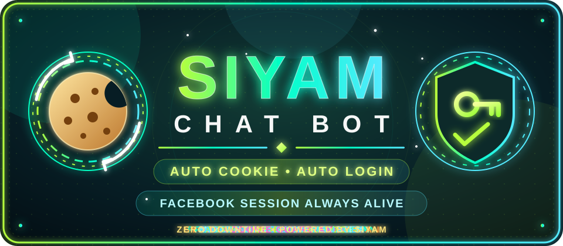

<!-- ═════════════════════ SIYAM CHAT BOT ═════════════════════ -->

<p align="center">
  
</p>

<p align="center">
  
</p>

<h1 align="center">👑 𝐒𝐈𝐘𝐀𝐌 𝐇𝐀𝐒𝐀𝐍 👑</h1>
<h3 align="center">⚡ Premium Messenger Automation System</h3>

<p align="center">
  
</p>

<p align="center">
  
  
  
  
  
</p>

<p align="center">
  
</p>

<p align="center">
  
</p>

---

## 🤖 ABOUT THE BOT

**SIYAM CHAT BOT** is a Facebook Messenger automation project built with a Mirai + GoatBot hybrid compatibility system.

- Mirai command and event support
- GoatBot compatibility layer
- Inbox and group command support
- Automatic reconnect and launcher
- Cookie Guardian integration
- Render Keep-Alive integration

📚 Compatibility Guide: [GOAT_COMPAT.md](GOAT_COMPAT.md)

📜 Command List: [COMMANDS.md](COMMANDS.md)

---

## 🍪 AUTO COOKIE & AUTO LOGIN

<p align="center">
  
</p>

<p align="center">
  
  
  
</p>

Guardian-এর মাধ্যমে Facebook session পরীক্ষা, cookie synchronization এবং recovery চালানোর ব্যবস্থা রয়েছে।

### Setup

1. `guardian/` ফোল্ডারসহ প্রয়োজনীয় ফাইল রাখুন।
2. Hosting Environment Variables-এ প্রয়োজনীয় তথ্য দিন:

```env
FB_EMAIL=your_facebook_email
FB_PASSWORD=your_facebook_password
FB_TOTP_SECRET=your_totp_secret
```

3. Playwright প্রয়োজন হলে ইনস্টল করুন:

```bash
npm install
npm i --no-save playwright
npx playwright install chromium
```

4. Guardian চালাতে:

```bash
node guardian/start.js
```

**Security:** Facebook password, TOTP secret ও appstate কখনো Public GitHub-এ রাখবেন না। Facebook CAPTCHA বা identity verification চাইলে নিজে সম্পন্ন করতে হবে।

---

## 🌐 RENDER AUTO KEEP-ALIVE

<p align="center">
  
</p>

<p align="center">
  
  
  
</p>

এই প্রজেক্টে `SiyamKeepalive.js` রয়েছে।

`Siyam.js`-এর শুরুতেই এটি যুক্ত করা আছে:

```js
require("./SiyamKeepalive");
```

Render-এর `RENDER_EXTERNAL_URL` পাওয়া গেলে Keep-Alive নিজের service-এ নির্দিষ্ট সময় পরপর request পাঠায়।

### Environment Variables

| Variable | কাজ |
|---|---|
| `KEEPALIVE_URL` | Custom service URL |
| `KEEPALIVE_INTERVAL_MS` | Ping interval; default 240000 ms |

### Start Command

```bash
npm start
```

**নোট:** `SiyamKeepalive.js` আলাদা bot launcher নয়। এটি `Siyam.js` থেকে load হয়। তাই `node JuwelKeepalive.js` বা `node SiyamKeepalive.js` ব্যবহার করবেন না।

Hosting provider-এর sleep policy ও plan অনুযায়ী uptime নির্ভর করে।

---

## 📡 TELEGRAM START / STOP NOTICE

<p align="center">
  
</p>

<p align="center">
  
  
  
</p>

Telegram notification-এর জন্য আলাদা alert module রয়েছে।

সম্ভাব্য notification:

- 🟢 Bot Started
- 🔴 Bot Stopped
- 🚨 Session Alert
- ✅ Back Online

**গুরুত্বপূর্ণ:** বর্তমান alert module-এর configuration key এবং `config.json`-এর `SIYAM_ALERT` key এক নয়। তাই কোডে configuration migration না করা পর্যন্ত এই notification system-কে সম্পূর্ণ configured ধরে নেবেন না।

Telegram Bot Token কখনো README বা Public Repository-তে লিখবেন না।

---

## ✨ FEATURES

| Feature | Description |
|---|---|
| 🤖 Auto Reply | Auto response system |
| 🎮 Quiz & Games | Quiz, Casino, Bầu Cua |
| 💰 Economy | Daily coins, EXP, rank |
| 👥 Group Management | Add, kick, lock, tag, rename |
| 📥 Media Downloader | YouTube, Facebook, TikTok |
| ⚡ Fast Response | Reconnect support |
| 🖼️ Photo Editing | AI edit and image tools |
| 🎨 Image Generation | Flux and Pollinations tools |
| 😂 Fun Commands | Meme, slap, hug, pet |
| ⚡ No Prefix | Trigger-based response |
| 📥 Inbox Support | Inbox and group support |
| 🛡️ Security | Anti-flood and anti-spam tools |
| 🔀 Hybrid Engine | Mirai + GoatBot compatibility |
| 🕌 Islamic Pack | Sura and Islamic commands |
| 🌐 Keep-Alive | Render self-ping integration |

---

## ⚡ NO PREFIX SYSTEM

নির্দিষ্ট trigger ব্যবহার করে prefix ছাড়াই কিছু response পাওয়া যায়।

| Trigger | কাজ |
|---|---|
| `jwl` | Reaction |
| `autoreplybot` | Auto reply |
| `autovoice` | Auto voice |
| `baby` | AI auto chat |
| `Gan` | Random song |
| `umma` | Fun response |
| `night` | Fun response |
| `women` | Fun response |
| `👀` / `😅` | Emoji response |
| `salam` | Salam reply |
| `hi` | Sticker reply |
| `bot` | Random reply |
| `fixspam` | Spam detection |
| `autoseen` | Auto seen |
| `autodl` | Auto download |
| `shortcut` | Custom shortcut |
| `prefix` | Prefix information |

---

## 📥 INBOX SUPPORT

`allowInbox: true` থাকলে inbox-এ command ব্যবহারের সুবিধা পাওয়া যায়।

- `notice` — Group notice
- `sendsms` — Group message
- `outall` — Multiple group message
- `acp` — Friend request management
- `listfriend` — Friend list
- `pending` — Pending requests
- `join` — Group join management

---

## 🐾 ANIMAL POWER SYSTEM

| Mode | Power |
|---|---|
| 🦁 Lion | Admin power control |
| 🐺 Wolf | Fast auto reply |
| 🦅 Eagle | Smart detection |
| 🐯 Tiger | High-speed execution |
| 🐉 Dragon | AI power |
| 🦂 Scorpion | Security shield |

---

## 🛡️ PROTECTION & EVENTS

| System | কাজ |
|---|---|
| `antiflood` | Message flood protection |
| `spamban` | Repeated spam control |
| `botautoban` | Bot detection |
| `antigali` | Anti-gali |
| `anti18` | 18+ word detection |
| `antiout` | Member leave control |
| `antijoin` | New member control |
| `antiProtect` / `protect` | Group settings protection |
| `guardian` | Owner protection |
| `blacklistuser` | Blacklist control |
| `bossleave` | Kick event handling |
| `joinNoti` | Join notification |
| `leave` | Leave notification |
| `adminUpdate` | Group update notification |
| `lock` / `textoff` | Group chat lock |
| `vip` | VIP user management |

---

## 🧠 COMMANDS

<p align="center">
  
  
  
</p>

বর্তমান `config.json` অনুযায়ী default prefix হলো `.`।

ব্যবহার করুন:

```text
.help
.helpall
.menu
```

### 🛠️ SYSTEM & ADMIN

`help` · `helpall` · `menu` · `system` · `uptime` · `upt` · `status` · `restart` · `offbot` · `load` · `config` · `settings` · `setbot` · `adminonly` · `adminupdate` · `self` · `listbox` · `allbox` · `pending` · `join` · `vip` · `file` · `give` · `install` · `console` · `setprofile` · `setexp` · `delmsg` · `unsend` · `theme` · `notice` · `sendsms` · `outall` · `out`

### 👥 GROUP & BOX CHAT

`group` · `groupname` · `groupimage` · `groupemoji` · `setemoji` · `setname` · `newbox` · `boxinfo` · `boxadmin` · `listadmin` · `adduser` · `kick` · `kickall` · `ban` · `lock` · `protect` · `tag` · `mention` · `tid` · `rules` · `setjoin` · `setprefix` · `birthday` · `bday` · `top` · `textoff`

### 🛡️ PROTECTION

`antiflood` · `antigali` · `anti18` · `antijoin` · `antiout` · `botautoban` · `spamban` · `autoban` · `fixspam` · `protect`

### 🤖 AI & IMAGE TOOLS

`gptgen` · `flux` · `poli` · `edit` · `editpro` · `refine` · `prompt` · `animate` · `art` · `4k` · `ai` · `baby`

### 📥 MEDIA & DOWNLOADER

`youtube` · `video` · `song` · `sing` · `sing2` · `mp3` · `allvideo` · `shoti` · `rasian` · `autodl` · `getlink` · `catbox` · `imgur` · `say` · `x` · `sigma` · `sigmaboy` · `attitude` · `sad` · `random`

### 🎴 BANNER & FRAME MAKERS

`couple` · `love` · `love1` · `crush` · `crush1` · `bf` · `gf` · `besti` · `bestu` · `bestfriend` · `bro` · `kiss` · `hug` · `hug2` · `married` · `pair` · `pairing` · `bonk` · `sala` · `chipa` · `toilet` · `rip1` · `fbcover` · `fbpost` · `post` · `family`

### 😂 FUN & MEME

`slap` · `slap2` · `batslap` · `pet` · `pat` · `jail` · `goru` · `chor` · `dim` · `arrest` · `bigtext` · `rip` · `tokai` · `pabna` · `fokir` · `pem` · `bijiboy` · `bijigirl` · `doya` · `shayri` · `caption` · `wish` · `war` · `boom` · `nokia` · `mix`

### 🎮 GAMES & ECONOMY

`quiz` · `casino` · `bc` · `daily` · `rank`

### 🧰 UTILITIES & TOOLS

`uid` · `profile` · `ckuser` · `ckbot` · `numinfo` · `age` · `weather` · `ss` · `qr` · `font` · `wallpaper` · `google` · `search` · `pic` · `github` · `ar` · `bn` · `en` · `text` · `scan` · `autoseen`

### 🕌 ISLAMIC

`ramadanauto` · `sura` · `islamick` · `islam` · `allah`

### 💞 LOVE & COUPLE

`lv` · `lv2` · `lv3` · `love2` · `love3` · `kiss1` · `kiss2` · `kiss3` · `married3` · `pair1` · `pair2` · `coupledp` · `animedp` · `boypp` · `girlpp` · `girl`

বিস্তারিত তালিকা: [COMMANDS.md](COMMANDS.md)

---

## ⚙️ CONFIG HIGHLIGHTS

| Option | বর্তমান মান | কাজ |
|---|---|---|
| `PREFIX` | `.` | Command prefix |
| `usePrefix` | `true` | Prefix enable |
| `allowInbox` | `true` | Inbox support |
| `autoSent` | `true` | Auto message |
| `autoCreateDB` | `true` | Database creation |
| `autoClean` | `true` | Auto clean |
| `Login.autoRetryLogin` | `true` | Login retry |
| `FCAOption.autoReconnect` | `true` | Reconnect |
| `DATABASE` | SQLite | Database |
| `ADMINBOT` | UID array | Bot admin |
| `DEVELOPER` | UID array | Developer |

নিজের Admin ও Developer UID সঠিকভাবে সেট করুন।

`appstate.json`, password, OTP secret এবং API token private রাখুন।

---

## 📊 GITHUB STATS

<p align="center">
  <a href="https://github.com/siyam-xpromex/siyambot">
    
  </a>
</p>

<p align="center">
  <a href="https://github.com/siyam-xpromex/siyambot"></a>
  <a href="https://github.com/siyam-xpromex/siyambot/network/members"></a>
  <a href="https://github.com/siyam-xpromex/siyambot/issues"></a>
</p>

---

## 🚀 LIVE DEPLOY

<p align="center">
  <a href="https://render.com"></a>
  <a href="https://railway.app"></a>
</p>

### Railway

এই repository-তে `railway.json`-এ `npm start` সেট করা আছে।

### Render

Build Command:

```bash
npm install
```

Start Command:

```bash
npm start
```

Node.js version: `22.x`

---

## 🚀 HOW TO RUN

```bash
git clone https://github.com/siyam-xpromex/siyambot.git
cd siyambot
npm install
npm start
```

প্রথমে `config.json`-এ নিজের Admin ও Developer UID দিন।

তারপর `appstate.json`-এ নিজের বৈধ Facebook session দিন।

**Launcher:** `Siyam.js`

`Main.js` সরাসরি চালাবেন না।

---

## 🧰 PLATFORM LINKS

| Platform | Link |
|---|---|
| GitHub Repository | [siyam-xpromex/siyambot](https://github.com/siyam-xpromex/siyambot) |
| Render | [render.com](https://render.com) |
| Railway | [railway.app](https://railway.app) |
| GoatBot Guide | [GOAT_COMPAT.md](GOAT_COMPAT.md) |
| Commands | [COMMANDS.md](COMMANDS.md) |

---

## 👤 DEVELOPER & SUPPORT

<p align="center">
  
  
</p>

<p align="center">
  <a href="https://wa.me/8801789138157">
    
  </a>
  <a href="https://t.me/ri_siyam">
    
  </a>
  <a href="https://www.facebook.com/profile.php?id=61596102516084">
    
  </a>
</p>

### 💬 SUPPORT GROUPS

<p align="center">
  <a href="https://chat.whatsapp.com/IbxqvkgbySJ10XsL7geN8B?s=cl&p=a&iam=2">
    
  </a>
  <a href="https://t.me/siyam_esb">
    
  </a>
</p>

---

<p align="center">
  
</p>

<h2 align="center">💙 SIYAM CHAT BOT ব্যবহার করার জন্য ধন্যবাদ!</h2>

<p align="center">
  <a href="https://github.com/siyam-xpromex/siyambot">
    
  </a>
</p>

<p align="center">
  
</p>
